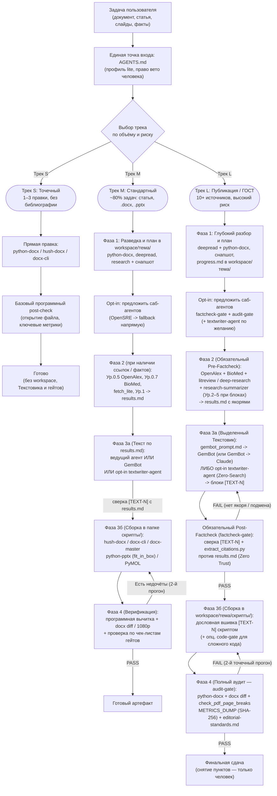

# Split & Merge — конвейер редактуры + каскад фактчекинга

[](https://github.com/DrHush47/SplitAndMerge/actions/workflows/ci.yml)

Гибридный конвейер для редактуры научных текстов по ГОСТ/журнальным стандартам
и автоматической верификации источников. Главная идея — не доверять LLM
без программной проверки.

**Единая точка входа — [`AGENTS.md`](AGENTS.md) (v2 — Agent-First Core):**
ведущий агент сессии сам подбирает глубину сценария под задачу (**3 адаптивных трека `S / M / L`**, **4 фазы**: разведка → фактбаза `results.md` → текст и сборка → программная верификация). Для объёмной генерации текстов `[TEXT-N]` доступны два изолированных режима: внешний Текстовик **[GemBot (Writing Editor)](https://gemini.google.com/gem/writing-editor)** (или связка `GemBot → Claude`) с автосборкой `gembot_prompt.md`, либо — по указанию пользователя в среде с саб-агентами — read-only саб-агент **`textwriter-agent`** (Zero-Search, напрямую по `results.md` и `editorial-standards.md`).

**Сфокусированные профили саб-агентов (`pipeline/prompts/subagents/`):** 3 read-only гейта проверки (`factcheck-gate`, `audit-gate`, `code-gate`) + opt-in генератор `textwriter-agent` работают с фиксацией на конкретном артефакте (Scope Pinning) — вызываются **только по согласию пользователя**, а в средах без саб-агентов (например, OpenSRE) гейты исполняются напрямую как изолированный проход по тем же чек-листам.

**7 уровней фактчекинга** — схема, эскалация, вердикты только в [`pipeline/docs/cascade.md`](pipeline/docs/cascade.md): ~95% проверок закрываются на бесплатных уровнях.

## Быстрый старт (лёгкий профиль `lite`, ~16,5 МБ)

> **Рекомендуемый путь для ~95% задач:** лёгкий профиль `lite` ставится за 5–10 секунд, не тянет тяжёлые браузеры (`Playwright`/`Chromium`) и включает всё нужное для редактуры `.docx`, чтения PDF/HTML, OpenAlex (Ур.0.5), BioMed Deep Check (Ур.0.7), биомед-навыков и ручного трека `manual`.
> Состав профиля зафиксирован в [`pipeline/requirements-lite.txt`](pipeline/requirements-lite.txt) и [`pyproject.toml`](pyproject.toml) (`python-docx`, `beautifulsoup4`, `pypdf`, `polite-http`, `python-dotenv`; сами скрипты `factcheck_openalex.py`, `factcheck_biomed.py` и `factcheck_manual.py` работают на стандартной библиотеке Python — **0 МБ**).

```bash
# 1. Настроить MCP-конфиг (при необходимости)
cp .agents/mcp.json.example .agents/mcp.json

# 2. Создать venv в КОРНЕ проекта и поставить лёгкий профиль (~16,5 МБ)
python -m venv .venv
.venv/Scripts/python.exe -m pip install -e ".[lite]"                     # Windows (рекомендуется, регистрирует команду `sam`)
# .venv/bin/python -m pip install -e ".[lite]"                           # Linux/Mac
# Альтернатива без editable-пакета:
# .venv/Scripts/python.exe -m pip install -r pipeline/requirements-lite.txt

# 3. Заполнить pipeline/targets.json ссылками для проверки
# 4. Запустить лёгкую верификацию (артефакты пишутся в workspace/)
.venv/Scripts/sam.exe --targets pipeline/targets.json --levels 0.5       # Ур.0.5 OpenAlex (DOI, с поддержкой RU↔EN)
.venv/Scripts/python.exe pipeline/biomed/factcheck_biomed.py --targets pipeline/targets.json --prefix bm --timeout 15  # Ур.0.7 BioMed (PMID/PMC)
.venv/Scripts/python.exe pipeline/lite/fetch_lite.py --targets pipeline/targets.json --prefix lite --timeout 15        # Лёгкий HTTP/meta/PDF-фетчер (без браузеров)
```

> **Пути для Windows vs Linux/macOS:**
> - Windows: `.venv/Scripts/sam.exe` и `.venv/Scripts/python.exe`
> - Linux/macOS (без `.exe`): `.venv/bin/sam` и `.venv/bin/python`
>
> После активации окружения (`.venv/Scripts/Activate.ps1` / `source .venv/bin/activate`) доступна короткая команда `sam`; при установке через `requirements-lite.txt` (без `-e`) используйте `.venv/Scripts/python.exe pipeline/sam.py` (Linux/macOS: `.venv/bin/python pipeline/sam.py`).

Коды выхода `sam.py`: `0` — нет REFUTED; `1` — есть REFUTED; `2` — ошибка конфигурации. Правила эскалации и handoff-уровни — только в [`pipeline/docs/cascade.md`](pipeline/docs/cascade.md). Для работы фазы 3 (Scrapling) всегда включайте уровень 2 в `--levels` (иначе фазе 3 не из чего эскалироваться).

### Расширенная установка (опционально, по запросу)

> **Правило для ИИ-агентов (см. [`AGENTS.md`](AGENTS.md)):** перед доустановкой **любых** пакетов сверх `lite` (особенно тяжёлого `[web]` ~1,5 ГБ) агент обязан запросить явное подтверждение пользователя с указанием списка пакетов, цели и ориентировочного объёма загрузки.

```bash
# Windows MS Word COM (.doc → .docx и PDF-проверка вёрстки, +19,5 МБ):
.venv/Scripts/python.exe -m pip install -e ".[lite,win-office]"

# Сборка презентаций .pptx (+18 МБ):
.venv/Scripts/python.exe -m pip install -e ".[lite,pptx]"

# Полный профиль с браузерными краулерами Crawl4AI + Scrapling (~1,56 ГБ с Playwright/Chromium — только для обхода Cloudflare / JS-SPA):
.venv/Scripts/python.exe -m pip install -e ".[lite,web,pptx]"
# или через requirements:
# .venv/Scripts/python.exe -m pip install -r pipeline/requirements.txt

# Авто-каскад с браузерными уровнями 2–3 (после установки `[web]`):
.venv/Scripts/sam.exe --targets pipeline/targets.json --out-dir workspace --levels 0.5,2,3
```

### Лёгкий профиль и ручной трек (Ур.0.5 / Ур.0.7 + Ур.1 → Ур.5)

> Workflow без браузерных краулеров, конвенция имён, дефект DOI-сверки — только в [`pipeline/manual/manual.md`](pipeline/manual/manual.md), здесь не дублируются.

### Обновление локального репозитория (для агентов и пользователей)

При получении обновлений из ветки `main`:
```bash
git pull origin main

# Обновить лёгкий профиль (по умолчанию, ~16,5 МБ):
.venv/Scripts/python.exe -m pip install -e ".[lite]"                     # Windows
# .venv/bin/python -m pip install -e ".[lite]"                           # Linux/Mac

# Только если у вас уже установлен полный профиль (с тяжёлыми краулерами ~1,56 ГБ):
# .venv/Scripts/python.exe -m pip install -e ".[lite,web,pptx]"
```

## Документация

| Файл | Назначение |
|------|-----------|
| [`AGENTS.md`](AGENTS.md) | **Единая точка входа** для ИИ-агентов — guardrails, треки `S/M/L`, GemBot Handoff, opt-in гейты, маршрутизация SSOT |
| [`docs/architecture.md`](pipeline/docs/architecture.md) | Архитектура ядра v2 — разделение по артефактам и гейтам, треки `S/M/L`, 4 фазы, 8 неизменяемых принципов |
| [`docs/editorial-standards.md`](pipeline/docs/editorial-standards.md) | Единый канон качества текстов — аннотации, 2 режима `References` (без смешивания стилей), типографика и антипаттерны |
| [`docs/knowledge.md`](pipeline/docs/knowledge.md) | Каскад веб-фактчекинга — техконстанты, команды запуска |
| [`docs/cascade.md`](pipeline/docs/cascade.md) | Единый источник схемы каскада — 7 уровней, правила эскалации, словарь вердиктов |
| [`docs/docx-protocol.md`](pipeline/docs/docx-protocol.md) | Протокол правки и программной вычитки `.docx` через `python-docx` — правила, шаблоны, антипаттерны |
| [`docs/presentation-protocol.md`](pipeline/docs/presentation-protocol.md) | Протокол сборки презентаций `.pptx` — триада доклада, `fit_in_box`, автоподбор Ultra-HD ассетов, экспорт 1080p |
| [`docs/biomed-protocol.md`](pipeline/docs/biomed-protocol.md) | Протокол биомедицинского модуля и Ур.0.7 (BioMed Deep Check) — PubMed, Europe PMC, HPA, ClinicalTrials |
| [`docs/research-skills.md`](pipeline/docs/research-skills.md) | Канон 5 исследовательских навыков (`deep-research`, `litreview`, `deepread`, `research`, `research-summarizer`) — карта по фазам/гейтам, границы, команды скриптов |
| [`docs/llm.md`](pipeline/docs/llm.md) | Полное руководство по prompt engineering — техники, шаблоны, безопасность (Anthropic, OpenAI, Google, Meta, OWASP) |
| [`pipeline/manual/manual.md`](pipeline/manual/manual.md) | Лёгкий профиль `lite` (без браузеров) и ручной трек (Ур.1→Ур.5) — состав, workflow, конвенция имён, референс сканера |
| [`prompts/`](pipeline/prompts/) | Внешний Текстовик [`prompts/textwriter.md`](pipeline/prompts/textwriter.md) ([Writing Editor / GemBot](https://gemini.google.com/gem/writing-editor) или `GemBot → Claude`) + 4 шаблона саб-агентов в [`prompts/subagents/`](pipeline/prompts/subagents/) (гейты `factcheck-gate`, `audit-gate`, `code-gate` + opt-in генератор `textwriter-agent`) |

### Карта чтения

Порядок чтения: [`AGENTS.md`](AGENTS.md) (единая точка входа) → [`pipeline/docs/architecture.md`](pipeline/docs/architecture.md) → нужный профильный канон под задачу (`pipeline/docs/editorial-standards.md` для текстов и `References`; `pipeline/docs/cascade.md` + `pipeline/docs/knowledge.md` §0.1 для фактчекинга; `pipeline/docs/docx-protocol.md` для `.docx`; `pipeline/docs/presentation-protocol.md` для `.pptx` и триады доклада; `pipeline/docs/biomed-protocol.md` для биомедицинского фактчекинга; `pipeline/docs/research-skills.md` для исследовательских навыков; `pipeline/manual/manual.md` для быстрого режима; `pipeline/prompts/textwriter.md` для внешнего Текстовика GemBot / `GemBot → Claude`; `pipeline/prompts/subagents/` для гейтов проверки; референс уровня `openalex/scrapling/firecrawl` только перед запуском).

Каноны (не дублируются в других файлах): редакционные стандарты и `References` — `editorial-standards.md`; схема и вердикты — `cascade.md`; команды и пути — `knowledge.md` §0.1; презентации и триада доклада — `presentation-protocol.md`; биомедицинский модуль — `biomed-protocol.md`; исследовательские навыки — `research-skills.md`; код шаблона `.docx` — `pipeline/templates/docx_orchestrator.py`.

## Структура проекта

```
├── README.md                         ← Этот файл
├── AGENTS.md                         ← Единая точка входа (v2) и таблица маршрутизации (SSOT) для ИИ-агентов
├── pyproject.toml                    ← Пакет проекта: установка и команда `sam`
├── skills-lock.json                  ← Лок внешних навыков (docx,
│                                       find-skills с GitHub; локальные
│                                       hush-* и research-навыки — вне лока)
├── .gitignore / .editorconfig        ← Конфиги git и редактора
├── .venv/                            ← Виртуальное окружение (вне git)
├── workspace/                        ← Каталог артефактов сессий (создаётся скриптами при запуске, вне git)
├── tests/                            ← pytest-набор тестового ядра (вне установки)
├── sandbox/                          ← Локальный полигон экспериментов (только локально, вне git)
│
├── .agents/                          ← Навыки и MCP-конфиг
│   ├── mcp.json.example              ← Шаблон MCP-серверов
│   └── skills/                       ← 20 навыков (10 базовых +
│                                       10 биомедицинских: pubmed,
│                                       europepmc, biorxiv, clinical_trials,
│                                       hpa, uniprot, chembl, openfda,
│                                       pdb, pymol)
│
└── pipeline/                         ← Основной код конвейера
    ├── __init__.py                   ← Пакет
    ├── common.py                     ← Общие утилиты (prefix-валидация,
    │                                    чтение targets.json)
    ├── sam.py                        ← Главный скрипт: авто-каскад
    ├── verdicts.py                   ← Вердикты и evidence-states
    ├── requirements-lite.txt         ← Лёгкий профиль lite (~16,5 МБ, без браузеров, ~95% задач)
    ├── requirements.txt              ← Полный профиль (~1,56 ГБ с браузерными краулерами и .pptx)
    ├── targets.json                  ← Цели для проверки (заполняется
    │                                    перед запуском)

    ├── docs/                         ← Документация (9 файлов)
    │   ├── architecture.md           ← Архитектура ядра v2 (треки S/M/L, 4 фазы, 8 принципов)
    │   ├── editorial-standards.md    ← Канон качества текстов, 2 режима References, антипаттерны
    │   ├── knowledge.md              ← Каскад фактчекинга
    │   ├── cascade.md                ← Единый источник схемы каскада
    │   ├── docx-protocol.md          ← Протокол правки и вычитки .docx
    │   ├── presentation-protocol.md  ← Протокол сборки презентаций (.pptx)
    │   ├── biomed-protocol.md        ← Протокол биомедицинского модуля
    │   ├── research-skills.md        ← Канон исследовательских навыков
    │   └── llm.md                    ← Prompt engineering (полное руководство)

    ├── prompts/                      ← Внешний Текстовик и профили саб-агентов
    │   ├── textwriter.md             ← Шаблон внешнего Текстовика (GemBot / GemBot → Claude)
    │   └── subagents/                ← 3 read-only гейта + opt-in генератор (Scope Pinning)
    │       ├── factcheck-gate.md     ← Независимая сверка фактов, ссылок и якорей
    │       ├── audit-gate.md         ← Программная и редакционная вычитка .docx/.pptx
    │       ├── code-gate.md          ← Точечный аудит сложных скриптов правки
    │       └── textwriter-agent.md   ← Opt-in генератор [TEXT-N] (Read-Only + Zero-Search)
    ├── templates/                    ← Шаблоны и канон-код
    │   ├── progress.template.md      ← Опциональный журнал сессии (Треки M/L)
    │   └── docx_orchestrator.py      ← Канон кода шаблона .docx

    ├── openalex/                     ← Ур.0.5 — валидация DOI
    │   ├── factcheck_openalex.py     ← Скрипт: OpenAlex REST API
    │   └── openalex.md               ← Референс команд
    │
    ├── biomed/                       ← Ур.0.7 — BioMed Deep Check
    │   ├── factcheck_biomed.py       ← Скрипт: PubMed / Europe PMC API
    │   └── biomed.md                 ← Референс команд
    │
    ├── crawl4ai/                     ← Ур.2 — базовый HTTP-парсинг
    │   └── factcheck_crawl4ai.py     ← Скрипт: Crawl4AI
    │
    ├── scrapling/                    ← Ур.3 — обход Cloudflare
    │   ├── factcheck_scrapling.py    ← Скрипт: Scrapling StealthySession
    │   └── scrapling.md              ← Референс команд
    │
    ├── lite/                         ← Лёгкий HTTP/meta/PDF-фетчер (без браузеров)
    │   └── fetch_lite.py             ← Скрипт: urllib + BeautifulSoup + pypdf (citation_*, HTML, PDF)
    │
    ├── manual/                       ← Лёгкий профиль (без браузеров) и ручной трек (Ур.1→Ур.5)
    │   ├── factcheck_manual.py       ← Сканер ручных источников (stdlib-only)
    │   └── manual.md                 ← Референс режима
    │
    └── firecrawl/                    ← Ур.4 — платный резерв
        └── firecrawl.md              ← Референс команд
```

## Сценарий рабочих сессий (треки S / M / L)



> Детализация ролей, гейтов и 8 принципов — в [`pipeline/docs/architecture.md`](pipeline/docs/architecture.md), правила эскалации 7 уровней каскада — в [`pipeline/docs/cascade.md`](pipeline/docs/cascade.md).
