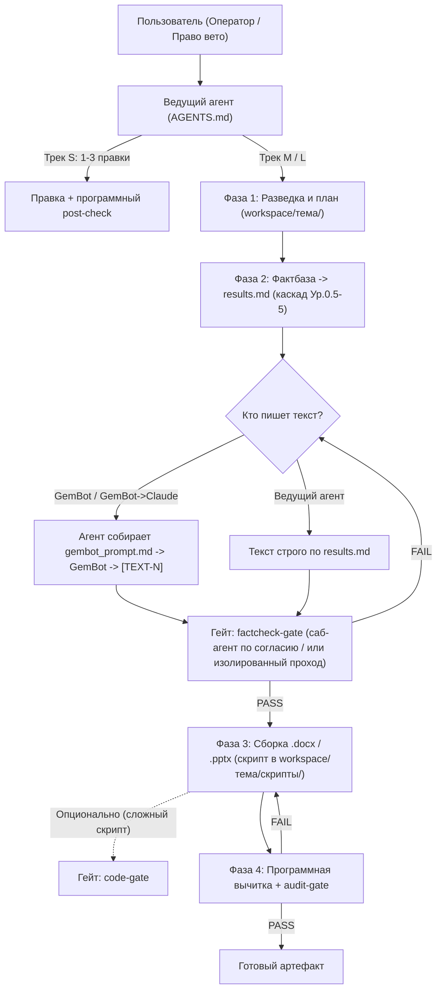

# Архитектура ядра Split & Merge (v2 — Agent-First Core)

> **Концепция:** гибридный конвейер редактуры научных текстов, сборки документов и программного фактчекинга. Главная идея остаётся прежней — **не доверять LLM без программной проверки и верифицированного сырья**.
>
> **Входная точка для любого агента:** [`AGENTS.md`](../../AGENTS.md).

---

## 1. Философия v2: разделение по артефактам и гейтам

Раньше конвейер требовал вручную разносить задачу по 5 разным окнам чата (Оркестратор, Рецензент, Текстовик, Технический исполнитель, Факт-чекер) и проходить жёсткую лестницу из 10 этапов. В современных сильных агентных средах (Antigravity, FreeBuff, Claude Code, OpenCode, Codex, OpenSRE и др.) один агент способен вести весь цикл.

Поэтому в **Split & Merge v2** принцип **Split & Merge** разделяет не «окна чата», а:
1. **Фазы и жёсткие артефакты между ними:** сырая фактбаза (`results.md`) ≠ текстовые блоки (`[TEXT-N]`) ≠ механическая сборка (`.docx` / `.pptx`) ≠ верификация (код + независимый аудит).
2. **Исполнение и проверку (Zero Self-Confirmation):** ведущий агент не верит своему самоотчёту — на выходе всегда работает программная проверка (`python-docx`, `docx diff`, `sam.py`, 1080p PNG) и, при согласии пользователя, read-only саб-агент со свежим контекстом.
3. **Универсального агента и специализированный внешний Текстовик:** когда нужно много академического текста с жёсткими лимитами, генерацию выгодно выносить в **GemBot (Writing Editor)** или двухэтапную связку **GemBot → Claude**.

---

## 2. Топология участников

- **Человек (Оператор):** ставит задачу, выбирает приоритеты, обладает **правом вето** (только человек снимает пункты чек-листа и разрешает доустановку пакетов сверх `lite`), закрывает ручной уровень фактчекинга (Ур.5).
- **Ведущий агент (Lead Agent):** единый координатор и исполнитель сессии. Сам подбирает трек (`S / M / L`), запускает каскад фактчекинга, собирает пакет для GemBot (если нужно), пишет и прогоняет скрипты сборки и программной вычитки.
- **Внешний Текстовик (опционально — [Writing Editor / GemBot](https://gemini.google.com/gem/writing-editor) или связка `GemBot → Claude`):** оптимален для генерации объёмных блоков `[TEXT-N]` без расхода коммерческих токенов (шаблон [`../prompts/textwriter.md`](../prompts/textwriter.md)). В связке `GemBot → Claude` первый собирает фактологический каркас по ТЗ, второй выполняет академическую редактуру («хуманизацию»), естественный перевод English Abstract и сквозной аудит.
- **Сфокусированные гейты (`factcheck-gate`, `audit-gate`, `code-gate`):** шаблоны в [`../prompts/subagents/`](../prompts/subagents/) для независимой проверки конкретного артефакта.

---

## 3. Адаптивные треки (`S / M / L`) и 4 фазы

### Выбор трека
- **Трек S (Точечный):** 1–3 локальные правки, мелкое форматирование, быстрая справка без новой библиографии → правка напрямую + программный post-check. Журнал `progress.md` и саб-агенты не нужны.
- **Трек M (Стандартный, ~80% задач):** редактура `.docx`, сборка `.pptx` и триады доклада, работа со статьёй и ссылками → 4 фазы в `workspace/<тема>/`, программная проверка; опционально журнал сессии и рекомендация 1 гейта.
- **Трек L (Публикация / Высокий риск):** статья в рецензируемый журнал, >10 источников, жёсткий ГОСТ / `References` → полный цикл с Pre/Post-factcheck, внешним `GemBot` (или `GemBot → Claude`), снапшотом исходника, журналом сессии и рекомендацией `factcheck-gate` + `audit-gate`.

### 4 рабочие фазы (для Треков M / L)

| Фаза | Что делаем | Ключевые артефакты и каноны |
|---|---|---|
| **1. Разведка и план** | Читаем исходник и требования (`python-docx` / `deepread`), группируем нарушения (Критические / Серьёзные / Прочие), делим на «текст» и «механику», маршрутизируем поиск (`research`). | `workspace/<тема>/`, снапшот исходника, опц. [`progress.template.md`](../templates/progress.template.md) |
| **2. Фактбаза (Pre-Factcheck)** | Если есть библиография, факты или URL — проверяем по каскаду ([`cascade.md`](cascade.md): Ур.0.5 OpenAlex, Ур.0.7 BioMed, лёгкий фетчер `lite`, Ур.1–5; методологии `litreview` / `deep-research` / `research-summarizer`). Каждый факт — с якорем (раздел/страница/цитата). | `workspace/<тема>/results.md`, выгрузки `workspace/<тема>/` |
| **3. Текст и сборка** | **Текст:** либо агент собирает готовый `gembot_prompt.md` на базе [`textwriter.md`](../prompts/textwriter.md) + `results.md` → получает `[TEXT-N]` от GemBot, либо (при малом объёме) пишет сам строго по `results.md` и [`editorial-standards.md`](editorial-standards.md). **Post-Factcheck:** сверка `[TEXT-N]` против `results.md` (`factcheck-gate`). **Сборка:** правка `.docx` (`hush-docx` / `docx-cli` / `docx-master`, [`docx-protocol.md`](docx-protocol.md)), сборка `.pptx` ([`presentation-protocol.md`](presentation-protocol.md)) или PyMOL-рендер ([`biomed-protocol.md`](biomed-protocol.md)). | `gembot_prompt.md`, `[TEXT-N]`, `workspace/<тема>/скрипты/*.py`, итоговый `.docx` / `.pptx` |
| **4. Верификация** | Обязательная программная проверка (`python-docx` / `docx diff` / `check_pdf_page_breaks` / 1080p PNG) + редакционная сверка (`audit-gate`). При необходимости — 2-й точечный прогон скрипта для закрытия остатка (100%). | Отчёт проверки, финальный артефакт |

---

## 4. Протокол саб-агентов-гейтов (Opt-in & Environment-Safe)

В средах с поддержкой саб-агентов (Antigravity, Claude Code, FreeBuff, OpenCode и др.) гейты можно запускать в изолированном контексте, а в средах без саб-агентов (например, **OpenSRE**) или при отказе пользователя — выполнять напрямую по тем же шаблонам:

1. **Строго opt-in (без самовольного спавна):** ведущий агент **никогда не спавнит саб-агентов без указания пользователя**. В начале задачи Трека M/L агент лишь деликатно пишет в 1 строку: *«Проект рекомендует использовать саб-агент-гейт (`factcheck-gate` / `audit-gate`) в этой задаче — сообщите, если среда поддерживает саб-агентов и хотите их подключить»*.
2. **Scope Pinning (фиксация на конкретном объекте):** саб-агент никогда не получает расплывчатое «проверь всё». В бриф всегда вписываются конкретный путь/блоки (`TARGET` / `ARTIFACT` / `SCRIPT_PATH`) и эталон (`GROUND_TRUTH` / `BASELINE` / `REQUIREMENTS`).
3. **Read-Only по умолчанию:** саб-агент не правит файлы молча — он возвращает структурированный отчёт с координатами и вердиктом `PASS / FAIL`.
4. **Анти-переусложнение:** не предлагать саб-агентов для рутины (Трек S); на задачу обычно достаточно 1–2 точечных вызовов (`factcheck-gate`, `audit-gate`; `code-gate` — только для сложных скриптов >150–200 строк или рискованных правок таблиц).
5. **Graceful Degradation (Fallback):** если среда не поддерживает спавн саб-агентов или пользователь не активировал их, ведущий агент обязан пройти тот же чек-лист (`factcheck-gate.md` / `audit-gate.md`) отдельным явным шагом проверки перед сдачей результата.

---

## 5. Восемь неизменяемых принципов конвейера

1. **Выбирай инструмент под задачу, а не наоборот.** Для жёстких формальных текстов и экономии токенов — `GemBot` (или `GemBot → Claude`); для `.docx` — `python-docx` (`hush-docx` / `docx-cli` / `docx-master`); для библиографии — программный каскад (`OpenAlex` / `BioMed` / `lite`), а не память LLM.
2. **Большая модель не обязательно лучше для жёсткого формата.** Крупные модели склонны «креативничать» (переписывать числа прописью, вольно переводить названия, уходить в философский стиль). Формальные ограничения закрепляются в [`editorial-standards.md`](editorial-standards.md) и проверяются кодом.
3. **Человек-в-цикле необходим (право вето).** Только человек снимает пункты чек-листа, принимает стратегические компромиссы и утверждает доустановку пакетов сверх профиля `lite`.
4. **Встраивай критические данные в контекст и запрети синтетические URL.** Библиография, ГОСТ-правила и сырьё (`results.md`) передаются явно, а не «ищутся по наитию» при генерации текста. Категорически запрещено угадывать/транслитерировать веб-адреса (слаги КиберЛенинки, eLIBRARY, вузов) — только реальный URL из API/поиска или отсутствие URL.
5. **Не доверяй самоотчёту модели.** Заявление «всё исправлено» без программной проверки (`python-docx`, `docx diff`, подсчёт слов, проверка кириллицы, 1080p PNG) недостоверно.
6. **Итеративность — норма.** 1-й прогон скрипта обычно закрывает 80–90% правок; программная вычитка + 2-й точечный прогон надёжнее и дешевле попыток сделать 100% за один гигантский шаг.
7. **Двойная верификация фактчекинга (Zero Trust).** Сначала сбор верифицированного сырья (`results.md`, Pre-check), затем повторная сверка сгенерированных текстов `[TEXT-N]` с якорями (Post-check). *Эмпирическое обоснование:* без запрета на самовольный поиск модель фальсифицировала **9 из 27 источников** (кейс промпта v2); в другом тесте независимый гейт поймал **6 из 27 галлюцинированных статей (22%)**, прошедших все предыдущие проверки.
8. **Изоляция контекста задачи и процедурных скриптов (Session Workspace Containment).** Каждая прикладная задача ведётся в `workspace/<название_темы>/` (создаётся на лету через `parents=True, exist_ok=True`), все одноразовые скрипты сборки и проверки — строго в `workspace/<название_темы>/скрипты/`. `pipeline/` — только стабильное ядро; `sandbox/` — только R&D-полигоны платформы; корень `workspace/` не захламляется.

---

## Связанные каноны

- [`editorial-standards.md`](editorial-standards.md) — стандарты аннотаций, 2 режима `References`, антипаттерны
- [`cascade.md`](cascade.md) — 7 уровней фактчекинга, эскалация, словарь вердиктов (SSOT)
- [`knowledge.md`](knowledge.md) — техконстанты и команды запуска каскада (§0.1)
- [`docx-protocol.md`](docx-protocol.md) — протокол правки и программной вычитки `.docx`
- [`presentation-protocol.md`](presentation-protocol.md) — протокол сборки презентаций `.pptx` и триады доклада
- [`biomed-protocol.md`](biomed-protocol.md) — биомедицинский модуль (Ур.0.7 + 10 навыков + PyMOL)
- [`research-skills.md`](research-skills.md) — 5 исследовательских навыков (`deep-research`, `litreview`, `deepread`, `research`, `research-summarizer`)
- [`llm.md`](llm.md) — руководство по prompt engineering
