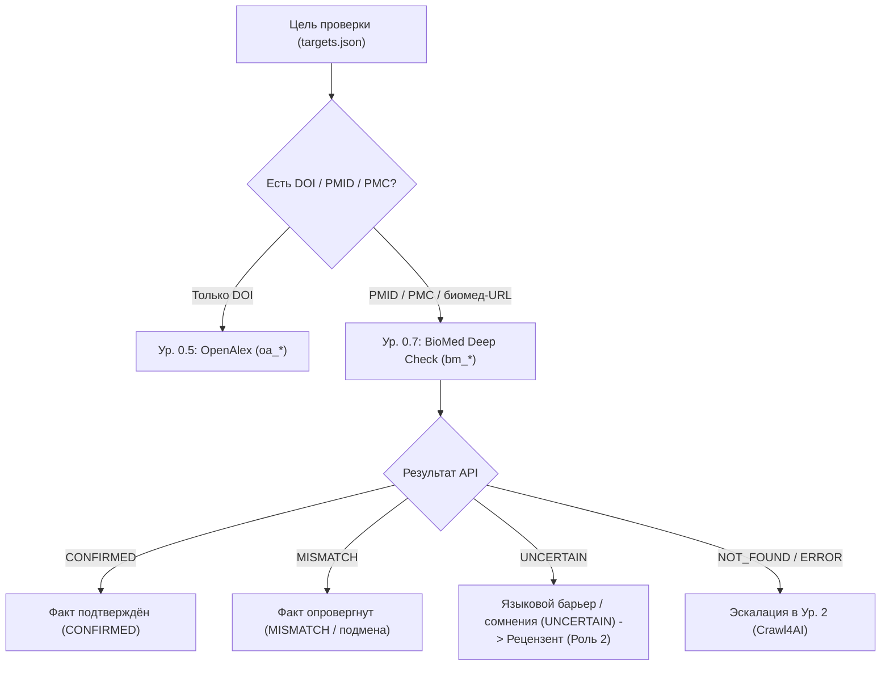

# biomed-protocol.md — Протокол научного биомедицинского модуля и Уровня 0.7 («BioMed Deep Check»)

> **Назначение модуля:**
> Автономная верификация, извлечение доказательной базы и оформление биомедицинских, клинических, гистологических и фармакологических данных (экспериментальные анатомические и гистологические исследования, международные клинические статьи). Обеспечивает прямой доступ к базам «золотого стандарта» (PubMed, Europe PMC XML, ClinicalTrials.gov, Human Protein Atlas, UniProt, ChEMBL, OpenFDA, PDB, PyMOL) без тяжёлого веб-скрапинга.
>
> **Роли в конвейере:**
> - **Факт-чекер (Роль 5):** быстрый запуск Ур. 0.7 (`factcheck_biomed.py`), извлечение фактов из структурированных XML/JSON, классификация вердиктов.
> - **Рецензент (Роль 2):** сверка заявленных в статье методик окраски, морфометрии, дозировок, тканевой экспрессии белков и клинических фаз.
> - **Текстовик (Роль 3):** обогащение библиографического аппарата References (подлинные PMID, PMCID, DOI, официальные международные названия журналов).
> - **Технический исполнитель (Роль 4):** headless-генерация молекулярных структур высокого разрешения через PyMOL/matplotlib в `.png` и интеграция в результирующие документы `.docx`.

---

## 1. Главные принципы и ограничения (Critical Constraints)

### 1.1 Абсолютная унификация (Zero Vendor-Lock)
* **ЗАПРЕЩЕНО:** Использовать или требовать проприетарные графические оболочки, WebGL-сайдкары (Mol* Viewer), протоколы `sidecar://` или специфичные MCP-серверы IDE.
* **ОБЯЗАТЕЛЬНО:** Весь научный стек исполняется в **100% headless-режиме** под управлением любого LLM-агента (`Claude Code`, `FreeBuff`, `OpenCode`, `Codex`, `Gemini CLI`, терминальный `agy`, CI/CD).
* **Среда выполнения и rate limits:** Единый интерпретатор `.venv` репозитория. Все сетевые взаимодействия идут через открытые публичные REST API с вежливым соблюдением rate limits:
  - **CLI-модуль каскада Ур. 0.7 (`factcheck_biomed.py`):** 100% стандартная библиотека Python (`urllib.request`), zero-dep, встроенная задержка `time.sleep(0.35)` (вежливый рейт-лимит для NCBI без API-ключа — не более 3 запросов в секунду).
  - **Агентские навыки (`.agents/skills/*`):** используют библиотеку `polite-http` (`http_client`) для адаптивного рейт-лимитинга, кэширования и повторных попыток при углублённом поиске в PubMed, Europe PMC, ChEMBL, UniProt, ClinicalTrials.gov и OpenFDA.

### 1.2 Принцип «Evidence-First» в биомедицине
* Абстрактов и мета-данных часто недостаточно для проверки параметров морфометрии, серийных срезов и концентраций. При сомнениях факт-чекер запрашивает полнотекстовый XML через Europe PMC (`europepmc_api.py`) или PubMed Central Open Access.
* Запрещено додумывать неподтверждённые биомаркеры и результаты окрасок: статус при отсутствии точного совпадения — строго `UNCERTAIN` или `MISMATCH`.
* **FP-киллер:** Одно лишь совпадение фамилии первого автора при 0% перекрытии темы/названия статьи бракуется как `MISMATCH` (защита от ложного подтверждения галлюцинаций LLM или подмены статьи одного автора).
* **Поддержка русскоязычного научного контура:**
  - Фамилии авторов проверяются с транслитерацией кириллицы (BGN/ICAO: *Иванов* <-> *Ivanov*, *Смирнов* <-> *Smirnov*).
  - Темы сопоставляются через двуязычный словарь морфологических, гистологических и медицинских корней (`миокард` <-> `myocard`, `гипертроф` <-> `hypertroph`, `гистолог` <-> `histolog`).
  - При наличии языкового барьера (русская формулировка факта против англоязычной статьи в PubMed), когда автоматический анализ не даёт однозначного подтверждения, выставляется статус `UNCERTAIN` (с эскалацией Рецензенту Роли 2), а не ложный `MISMATCH`.

---

## 2. Уровень 0.7 каскада: BioMed Deep Check

Уровень 0.7 располагается между быстрым мета-поиском (OpenAlex, Ур. 0.5) и браузерным краулингом (Crawl4AI/Scrapling, Ур. 2–3).



### Команды запуска
```bash
# Прогон биомедицинских целей (Windows):
.venv/Scripts/python.exe pipeline/biomed/factcheck_biomed.py --targets pipeline/targets.json --prefix bm --timeout 15

# Прогон биомедицинских целей (Linux / macOS):
.venv/bin/python pipeline/biomed/factcheck_biomed.py --targets pipeline/targets.json --prefix bm --timeout 15

# Предпросмотр целей без сетевых запросов:
.venv/Scripts/python.exe pipeline/biomed/factcheck_biomed.py --targets pipeline/targets.json --dry-run
```

Выходные артефакты сохраняются в `workspace/bm_{id}.txt`.

---

## 3. Реестр установленных биомедицинских навыков (.agents/skills/)

В проект интегрированы 10 канонических навыков, доступных агентам:

| Навык | Директория | Основной CLI-скрипт | Назначение |
|---|---|---|---|
| `pubmed_database` | `.agents/skills/pubmed_database/` | `scripts/pubmed_api.py` | Поиск в PubMed по PMID, авторам, терминам MeSH, извлечение аннотаций |
| `literature_search_europepmc` | `.agents/skills/literature_search_europepmc/` | `scripts/europepmc_api.py` | Выгрузка полных текстов статей в XML/BioC, поиск грантов и цитирований |
| `literature_search_biorxiv` | `.agents/skills/literature_search_biorxiv/` | `scripts/search_by_dates.py` | Мониторинг препринтов bioRxiv и medRxiv по датам и категориям |
| `clinical_trials_database` | `.agents/skills/clinical_trials_database/` | `scripts/clinical_trials_api.py` | Проверка протоколов и фаз исследований на ClinicalTrials.gov (API v2) |
| `human_protein_atlas_database` | `.agents/skills/human_protein_atlas_database/` | `scripts/hpa_cli.py` | Экспрессия белков по органам, тканям и клеточным типам человека |
| `uniprot_database` | `.agents/skills/uniprot_database/` | `scripts/uniprot_tools.py` | Справочник аминокислотных последовательностей, функций и таксономии |
| `chembl_database` | `.agents/skills/chembl_database/` | `scripts/chembl_api.py` | Фармакологическая активность, мишени, молекулярные формулы, IC50/Ki |
| `openfda_database` | `.agents/skills/openfda_database/` | `scripts/openfda_query.py` | Побочные эффекты, отзывы препаратов и регуляторные статусы FDA |
| `pdb_database` | `.agents/skills/pdb_database/` | `scripts/search_pdb.py` | Поиск и скачивание пространственных координат макромолекул (.cif / .pdb) |
| `pymol` | `.agents/skills/pymol/` | Рецепты в `references/` | Headless-рендер ленточных и поверхностных моделей белков в Ultra-HD PNG |

---

## 4. Запуск скриптов навыков через корневой .venv

Все скрипты вызываются строго через интерпретатор проекта:

```bash
# 1. Поиск в PubMed:
.venv/Scripts/python.exe .agents/skills/pubmed_database/scripts/pubmed_api.py output.json search_pubmed "cardiac hypertrophy histology" 5 relevance

# 2. Выгрузка аннотаций по списку PMID:
.venv/Scripts/python.exe .agents/skills/pubmed_database/scripts/pubmed_api.py abstracts.json fetch_article_abstracts "35113657,31234568"

# 3. Тканевая экспрессия белка (Human Protein Atlas):
.venv/Scripts/python.exe .agents/skills/human_protein_atlas_database/scripts/hpa_cli.py search "GATA4"

# 4. Проверка клинического испытания (ClinicalTrials.gov):
.venv/Scripts/python.exe .agents/skills/clinical_trials_database/scripts/clinical_trials_api.py study "NCT04280705"
```

---

## 5. Взаимодействие ролей конвейера

1. **Факт-чекер (Роль 5):**
   При классификации статьи как биомедицинской запускает `factcheck_biomed.py`. При необходимости углублённой сверки использует скрипты `pubmed_api.py` и `europepmc_api.py`.
2. **Рецензент (Роль 2):**
   Проверяет корректность указания дозировок, реактивов, антител (через HPA) и номеров NCT клинических исследований.
3. **Текстовик (Роль 3):**
   Формирует блок References с официальными англоязычными названиями журналов и кодами идентификации (PMID / DOI) без искажения авторов.
4. **Технический исполнитель (Роль 4):**
   При необходимости визуализации макромолекул скачивает PDB-структуру через `pdb_database` и генерирует статичный PNG через headless PyMOL для автоматической вставки в итоговый `.docx` по протоколу [`docx-protocol.md`](docx-protocol.md).

---

## 6. Чек-лист Quality Gate перед коммитом
- [ ] Все вызовы сетевых утилит используют таймауты и корректные User-Agent.
- [ ] Скрипты не содержат жестких путей к глобальному Python.
- [ ] Тесты в `tests/test_biomed.py` проходят успешно (`pytest`).
- [ ] В `workspace/` отсутствуют бинарные дампы и неотслеживаемые логи.
